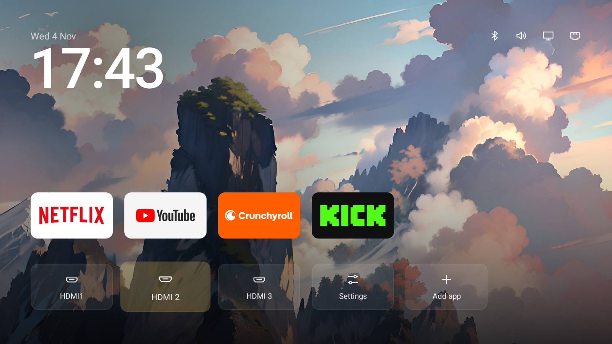

<div align="center">


**Make a slow, cluttered Android TV calm and fast again.**
An AI agent (Claude Code or Codex) cleans up your TV and installs a simple home screen. You press OK on the remote.

[](https://github.com/abouhilalbadr/quiet-home/actions)
[](LICENSE)



</div>

<table>
<tr>
<td width="33%" valign="top"><b>🧹 Removes the junk</b><br>Bloatware, ads and sponsored rows, turned off.</td>
<td width="33%" valign="top"><b>📺 A quiet home screen</b><br>Your apps, your HDMI inputs, a clock and a calm picture. Nothing else.</td>
<td width="33%" valign="top"><b>🎨 Yours to change</b><br>One settings file for apps, tiles, pictures, colours and clock. Your agent edits it for you.</td>
</tr>
</table>

## Get started with your AI agent

**1. Turn on developer mode on the TV.**
Settings → Device Preferences → About → press **Build** 7 times. Then turn on **USB debugging** in **Developer options**. [Stuck?](#help)

**2. Open [Claude Code](https://claude.com/claude-code) or [Codex](https://openai.com/codex) on your laptop.**
The laptop and the TV must be on the same network.

**3. Paste this in, and fill in the parts in `< >`.**

```text
Help me clean up my Android TV and install Quiet Home on it.
My TV is a <brand and model>.

1. Connect to my TV over the network with adb. Walk me through
   anything I need to press on the TV.
2. Before changing anything, list every app in plain English:
   safe to turn off, needed by the TV, and apps I use.
   Check free memory.
3. Ask me before every change. Turn apps off instead of
   deleting them. Keep a list of what you changed and how
   to undo it.
4. Never turn off: Google Play services
   (com.google.android.gms), Google Play, Settings,
   System UI, setup apps, the keyboard, Bluetooth, my HDMI
   inputs, the TV's input and tuner framework, or anything
   else the TV needs to start. If you're not sure, leave
   it on.
5. Install the home screen: clone
   https://github.com/abouhilalbadr/quiet-home and read its
   README. Put these apps in settings.conf: <your apps>.
   Install Java 17 and the Android SDK if they're missing,
   then run build.sh and install.sh with my TV.
6. Turn off animations and the screensaver, and make the TV
   sleep after 5 minutes.
7. Wait 30 seconds after the last change, then restart the
   TV once and check it starts up normally before you say
   you're done. Show me free memory before and after.
```

That's it. It asks you before every change.

> [!NOTE]
> This is what worked for us, not professional advice. Use it at your own risk. You're responsible for your own TV.

## Make it yours

Everything you're likely to change is in one file: [`settings.conf`](settings.conf). Each line is explained in the file itself. After a change, rebuild and reinstall:

```sh
sh build.sh && sh install.sh <TV_IP>
```

Or let your agent do it. Paste any of these into Claude Code or Codex, inside your `quiet-home` folder:

| You want to… | Ask your agent |
|---|---|
| Change the apps | *"Put Netflix, YouTube and Plex on the top row of Quiet Home, in that order. Find their package names on my TV, update settings.conf, rebuild and reinstall."* |
| Use your own tile art | *"Make a tile for Plex from this image, save it as a 16:9 PNG in tiles/ named after the app's package, rebuild and reinstall."* |
| Add your own backgrounds | *"Resize these pictures to 1920x1080, darken them a little behind the clock and apps, put them in backgrounds/, add them to settings.conf, rebuild and reinstall."* |
| Only plain backgrounds | *"Set backgrounds to none in settings.conf, rebuild and reinstall."* |
| Change the colour | *"Set the accent in settings.conf to Quiet Home's yellow, rebuild and reinstall."* |
| Change the clock | *"Show a 24-hour clock and a short date like Tue 4 Nov. Update settings.conf, rebuild and reinstall."* |
| Add shortcuts | *"Add Bluetooth and Sound shortcuts next to the clock in settings.conf, rebuild and reinstall."* |
| Make the tiles bigger | *"Set tiles_per_row to 4 in settings.conf, rebuild and reinstall."* |
| Change the bottom row | *"Take Play Store and Background off the bottom row in settings.conf, rebuild and reinstall."* |
| Rename the app | *"Call the home screen 'Living Room' in settings.conf, rebuild and reinstall."* |
| Something the file doesn't cover | *"Read src/com/abouhilalbadr/quiethome/MainActivity.java and change <what you want>. Keep it working on every TV, then rebuild, reinstall and show me a screenshot from the TV."* |

<details>
<summary><b>All settings</b></summary>
<br>

| Setting | What it does | Example |
|---|---|---|
| `name` | The app's name on the TV | `Quiet Home` |
| `app_id` | The app's ID. Keep it so updates replace the app; change it to install a second copy | `com.abouhilalbadr.quiethome` |
| `apps` | Top-row apps, by package name, in order | `com.netflix.ninja, com.google.android.youtube.tv` |
| `add_other_apps` | `yes`: fill the row with other installed TV apps. `no`: only your list | `yes` |
| `bottom_row` | Bottom-row tiles in order: `play_store`, `inputs`, `settings`, `background`, `add_app` | `inputs, settings, add_app` |
| `tiles_per_row` | Tiles in each row, `4` (biggest) to `8` (smallest). Apps past that slide in from the side | `4` |
| `shortcuts` | Icons by the clock: `bluetooth`, `sound`, `picture` | `bluetooth, sound` |
| `network_icon` | Show the Wi-Fi / Ethernet icon by the clock | `yes` |
| `clock` | `auto`, `12h`, `24h` or `off` | `24h` |
| `date` | Date pattern above the clock, empty for none | `EEE d MMM` |
| `accent` | Colour of the focus glow, menus and move outline | `#FFD166` |
| `backgrounds` | `all`, `none`, or file names from `backgrounds/` in order | `dusk.jpg, peaks.jpg` |
| `background_change` | `daily` or `fixed` | `fixed` |

Files that go with it:

- `tiles/<package>.png`: your own 16:9 art for an app's tile (516x290 works well).
- `backgrounds/*.jpg`: background pictures, 1920x1080.

**Keep your own setup apart.** Put your `settings.conf` (and optional `tiles/` and `backgrounds/` folders) in a folder outside the repo, then build and install with it:

```sh
SETTINGS=../my-tv/settings.conf sh build.sh
SETTINGS=../my-tv/settings.conf sh install.sh <TV_IP>
```

Pulling updates then never clashes with your changes.

</details>

## Using the remote

Hold **OK** on an app (or press **Menu**) to:

- **Move** it: use the arrows to slide it, then press **OK**.
- **Replace** it with another app.
- **Remove** it from the home screen. The app stays installed.
- **Uninstall** it (apps you installed) or open **App info** (apps that came with the TV).

Pick **Add app** in the bottom row to add one. Pick **Background** to see the next picture. Press **Up** from your apps to reach the icons by the clock.

Changes made with the remote stay until you rebuild with a different `apps` line in `settings.conf`.

## Help

<details>
<summary><b>How do I turn on developer mode?</b></summary>
<br>

1. On the TV, open **Settings**, then **Device Preferences** (or **System**), then **About**.
2. Press OK on **Build** 7 times until you see "You are now a developer."
3. Go back, open **Developer options** and turn on **USB debugging**. If you see **Network debugging** or **Wireless debugging**, turn that on too.
4. The first time your laptop connects, the TV asks "Allow debugging?" Tick "Always allow" and press **Allow**.

Menus differ a bit by brand. If you're stuck, ask your agent: *"I have a \<brand and model\> TV. How can you connect to it from my laptop?"*

</details>

<details>
<summary><b>Which TVs does it work on?</b></summary>
<br>

Every change is tested automatically on Android TV 9 and 11 emulators, and it's used every day on a TCL Android TV 11. The original TV Detox was also tested on Android TV 12 and Google TV 14.

Fire TV: the cleanup works, but Amazon blocks changing the home screen. Roku, Samsung (Tizen) and LG (webOS) don't run Android, so it can't connect to them.

</details>

<details>
<summary><b>The Claude app says it can't reach my TV</b></summary>
<br>

The chat in the Claude app and on claude.ai runs on Anthropic's servers, so it can't see your TV. You need an agent that runs on your own laptop: [Claude Code](https://claude.com/claude-code) or [Codex](https://openai.com/codex). Or skip the AI and use the scripts below.

</details>

<details>
<summary><b>Can I install it without AI?</b></summary>
<br>

Yes. You need `adb`, Java 17 and the Android SDK. On a Mac:

```sh
brew install android-platform-tools openjdk@17
brew install --cask android-commandlinetools
sdkmanager "platforms;android-34" "build-tools;34.0.0"
```

Then edit `settings.conf` and run:

```sh
sh build.sh
sh install.sh <TV_IP>
```

Most TVs keep opening their own home screen, so `install.sh` offers to turn that off. Nothing is uninstalled.

</details>

<details>
<summary><b>Can I just do the cleanup and keep my TV's home screen?</b></summary>
<br>

Yes. Leave out step 5 of the prompt. Your TV looks the same, just with the junk turned off.

</details>

<details>
<summary><b>The TV still opens Live TV or HDMI when it turns on</b></summary>
<br>

That's a TV setting, not this home screen. Ask your agent: *"My TV opens Live TV at startup instead of the home screen. Find that setting and turn it off."*

</details>

<details>
<summary><b>A button on the remote stopped working</b></summary>
<br>

Some remote buttons are handled by the TV's own home screen or by apps the cleanup turned off. Ask your agent: *"Run `adb shell dumpsys window policy` and tell me which apps my remote's buttons go to."* If one of them is turned off and isn't your TV's home screen, turn it back on.

</details>

<details>
<summary><b>An update turned something back on</b></summary>
<br>

```sh
sh check.sh <TV_IP>                  # check Quiet Home is still the home screen
sh check.sh <TV_IP> --fix            # and fix it
sh check.sh <TV_IP> --fix my-tv.txt  # also check your own list of changes
```

Your list has one change per line, like `off com.example.app`, `global window_animation_scale 0` or `device_config activity_manager max_cached_processes 4`. Ask your agent to write it from the changes it made.

</details>

<details>
<summary><b>How do I undo it?</b></summary>
<br>

```sh
sh undo.sh <TV_IP>
```

This turns your TV's own home screen back on and removes Quiet Home. To undo the cleanup too, ask your agent to reverse everything on its list.

</details>

<details>
<summary><b>My TV is stuck restarting</b></summary>
<br>

Your laptop can often still connect for a few seconds each time the TV starts. Use that to turn everything back on:

```sh
adb connect <TV_IP>
adb wait-for-device
for p in $(adb shell pm list packages -d | tr -d '\r' | sed 's/package://'); do adb shell pm enable "$p"; done
```

Then restart the TV. If the laptop never connects, use the TV's recovery mode or a factory reset; check your TV maker's support page.

</details>

<details>
<summary><b>For developers</b></summary>
<br>

- `sh build.sh` builds `out/quiet-home.apk` from `settings.conf`. It's plain Java, no libraries and no Gradle.
- `sh ci/smoke-test.sh <TV_IP or emulator>` installs it, checks it works, and undoes it.
- Keep `key.jks`, which is made on your first build: updates must be signed with the same key. It's never committed.
- The logo files are in [`brand/`](brand).

</details>

## Credits

Quiet Home started as a fork of [TV Detox](https://github.com/Ansub/tv-detox) by Ansub Khan (MIT). Background picture credits are in [`backgrounds/CREDITS.txt`](backgrounds/CREDITS.txt).

<div align="center"><sub>MIT License</sub></div>
